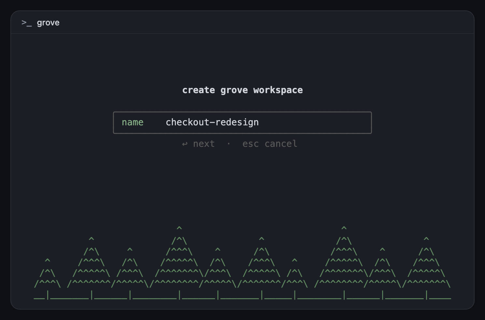
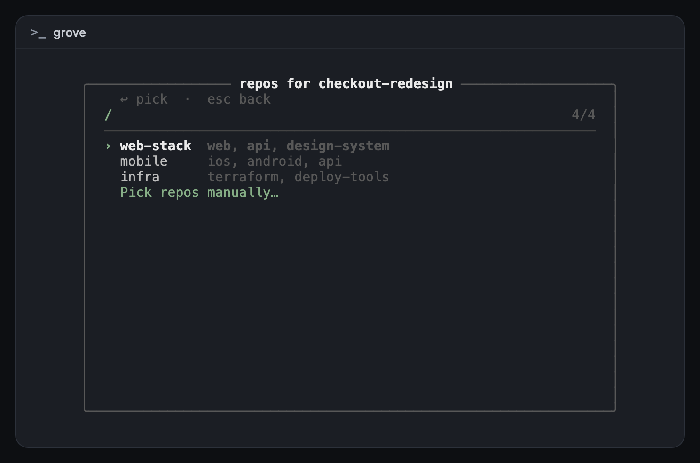
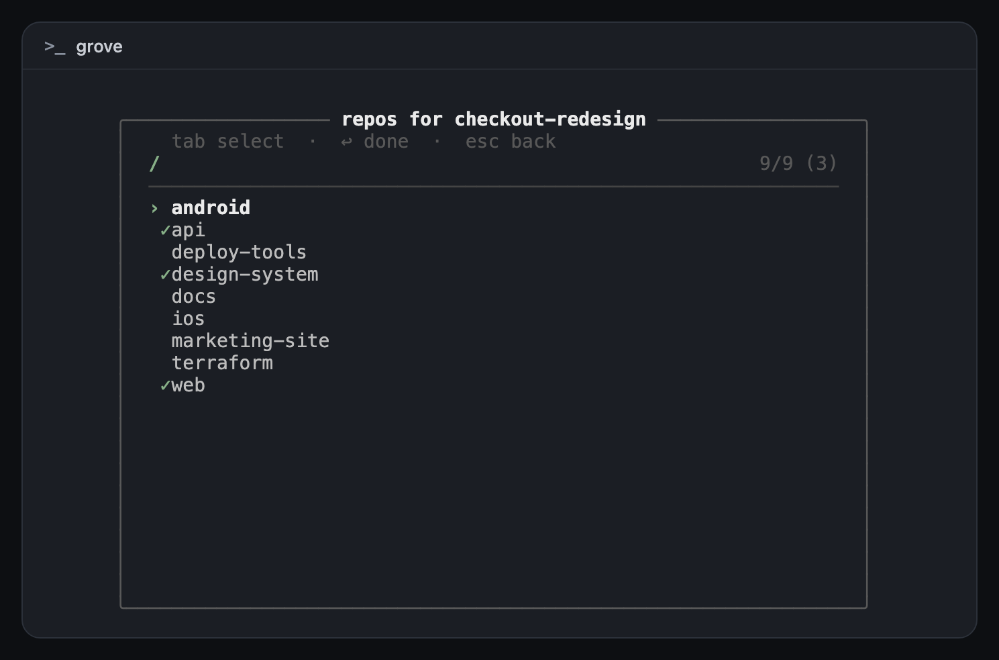
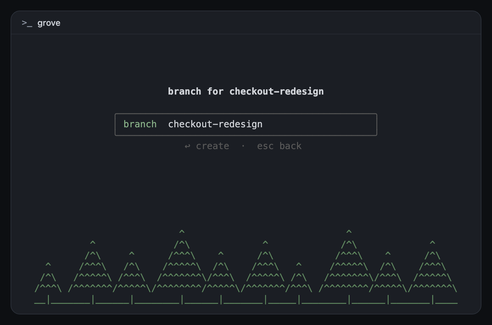

# grove-rex

[](https://github.com/nicksenap/grove-rex/actions/workflows/test.yml)

[Grove](https://github.com/nicksenap/grove) workspace create, inside [Rex](https://www.superlogical.com/rex).



`cmd+g` opens a popup. You name the workspace, pick a preset or repos, and confirm the branch. It then runs `gw create` and opens the workspace as a Rex session. `gw delete` (and `gw go -bd`) closes that session again.

It's the Rex counterpart of [grove-herdr](https://github.com/nicksenap/grove-herdr), and both can be installed at once.

Needs `rex`, `gw`, `fzf`, `jq`, `python3`, and `bash`. Works on macOS and on a Linux Rex server.

## Install

```bash
curl -fsSL https://raw.githubusercontent.com/nicksenap/grove-rex/main/install.sh | sh
```

From a clone: `./install.sh`

It clones to `~/.local/share/grove-rex` and adds a marked block to `~/.config/rex/init.lua` that loads `rex/grove.lua` and binds the key. It also points Grove's `pre_delete` hook at `hooks/pre-delete.sh`, then reloads the Rex config. Safe to re-run.

To choose another key the first time, set `GROVE_REX_KEY`:

```bash
curl -fsSL https://raw.githubusercontent.com/nicksenap/grove-rex/main/install.sh | GROVE_REX_KEY=ctrl+cmd+g sh
```

After that the key lives in `init.lua`, between the `grove-rex` markers. Edit it there and re-runs leave it alone. `cmd+g` is usually Find Next in a terminal, so pick another key if you use search.

**Rex app setting:** turn on **Remote Control** (Settings → Rex Server). The popup runs in a terminal, and switching the app to the new session goes through the CLI, which Rex.app only accepts with Remote Control on. Without it the session is still created, but you pick it in the sidebar yourself.

## Check

```bash
curl -fsSL https://raw.githubusercontent.com/nicksenap/grove-rex/main/check.sh | sh
```

From a clone: `./check.sh`

Prints PASS/FAIL for the tools, the plugin files, the `init.lua` block, the Grove hook, and whether the running Rex server has the `grove_create` action. `install.sh` runs this at the end.

## Update

Run the install command again. It pulls the latest `main` into `~/.local/share/grove-rex` and re-wires only what changed.

## Uninstall

```bash
~/.local/share/grove-rex/uninstall.sh
```

Removes the `init.lua` block and restores the `pre_delete` hook that was there before (or removes it). Leaves `~/.local/share/grove-rex` on disk.

## Use

1. Press `cmd+g`. A popup opens in the middle of the window.
2. Type a workspace name. Escape cancels.
3. Pick a preset, or **Pick repos manually…**: type to filter, Tab to select, Enter to confirm.
4. Confirm the branch. It defaults to the workspace name.
5. `gw create` runs. A Rex session opens on the workspace and the app switches to it.

| Preset or repos | Pick repos manually | Branch |
| --- | --- | --- |
|  |  |  |

Escape goes back one step. The command palette also has **Create Grove Workspace (Split Below)**, which runs the same flow in a pane under the focused one instead of a popup.

## Grove hooks

Grove has one `pre_delete` hook. If one is already set (for example grove-herdr's, which closes the Herdr workspace), install saves it to `~/.local/state/grove-rex/pre_delete.prev` and `hooks/pre-delete.sh` runs it first. Uninstall puts it back.

grove-herdr's own `check.sh` then reports its `pre_delete` as "runs something else". That's expected: it still runs, through grove-rex.

The session is killed only once the workspace directory is gone, from a detached process. `gw go -bd` usually runs inside that very session, and killing it straight away would stop `gw` mid-delete. Sessions are matched by label, so a session you've renamed isn't closed.

`post_create` isn't touched. A `gw create` typed by hand doesn't open a Rex session. The popup opens one itself.

## Remote Rex servers

Each Rex server reads its own `init.lua`, and the popup runs on the server whose session you're looking at. To use grove-rex on a remote Linux box, install it there too, with `gw`, `fzf`, and `jq` on that machine.

## Files

| Path | What it is |
| --- | --- |
| `rex/grove.lua` | The `grove_create` and `grove_create_below` Rex actions |
| `hooks/create.sh` | The popup: name, preset or repos, branch, `gw create`, Rex session |
| `hooks/pre-delete.sh` | Grove `pre_delete`: runs the previous hook, then kills the Rex session |
| `scripts/configure.py` | Idempotent edits to `init.lua` and Grove's `config.toml` |
| `tests/test-configure.sh` | Tests for `configure.py` and the hook chain. CI runs it on Ubuntu and macOS, along with shellcheck and Lua 5.1/Python syntax checks |
| `docs/` | Screenshots, taken with a stub `gw` and demo repos |
